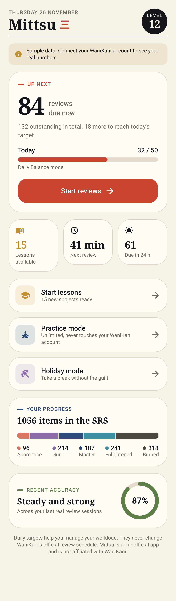
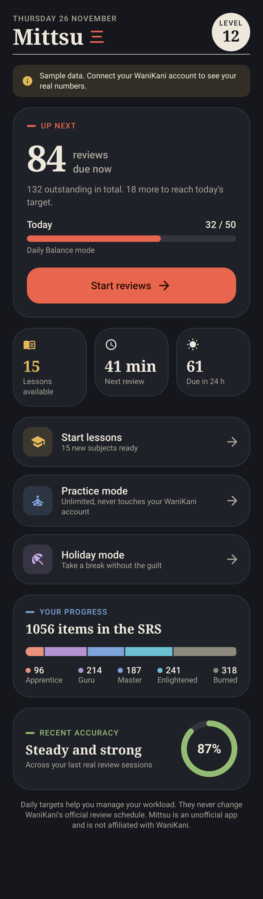

# Mittsu 三

An unofficial native Android companion for [WaniKani](https://www.wanikani.com) where every lesson and
review question is answered by tapping one of **three** answers. No keyboard during study.

> Mittsu is a third-party app. It is not made by or affiliated with WaniKani or Tofugu.
> WaniKani stays the source of truth for your account, SRS progress and review history.

| Light | Dark |
| --- | --- |
|  |  |

*Phase 1 dashboard with sample data.*

## Status

Built in phases (see [docs/ROADMAP.md](docs/ROADMAP.md)).

| Phase | What | State |
| --- | --- | --- |
| 1 | Project foundation, navigation, dashboard on sample data, visual identity | **Done** |
| 2 | WaniKani connection: token, profile, subjects, assignments, caching | Next |
| 3 | Three-answer quiz engine and difficulty | |
| 4 | Real reviews submitted to WaniKani | |
| 5 | Lessons and practice mode | |
| 6 | Smart review management (Daily Balance, Gentle Recovery) | |
| 7 | Holiday Mode | |
| 8 | Statistics, polish, offline | |

## Build

Requirements: JDK 17+ (21 recommended), Android SDK with **platform 37.2** and build-tools 37.

```bash
./gradlew :app:assembleDebug          # APK at app/build/outputs/apk/debug/app-debug.apk
./gradlew :app:testDebugUnitTest      # unit + Robolectric UI tests
```

Or open the folder in a current Android Studio and press Run.

Every push and pull request also builds on GitHub Actions; the debug APK is attached to the run as
the `mittsu-debug-apk` artifact.

### Installing on your phone

1. Download `app-debug.apk` (from a GitHub Actions run, or build it yourself).
2. On the phone, allow "Install unknown apps" for your browser or file manager.
3. Open the APK and install. The debug build installs as **Mittsu** with id `app.mittsu.debug`,
   so it can live alongside a future release build.

### Renaming the app

The name and application id are set in `gradle.properties`:

```properties
mittsu.appName=Mittsu
mittsu.applicationId=app.mittsu
```

Or override per build: `./gradlew assembleDebug -Pmittsu.appName="My Name"`.

### Design screenshots

```bash
./gradlew :app:testDebugUnitTest --tests '*ScreenshotCapture*' -Pmittsu.screenshots=$PWD/docs/screenshots
```

## WaniKani API token (from Phase 2)

Mittsu uses a personal access token, never your password. Create one at
<https://www.wanikani.com/settings/personal_access_tokens> with these permissions:

- default read access
- `reviews:create` (to submit reviews)
- `assignments:start` (to complete lessons)

The token will be stored encrypted with an Android Keystore key and is excluded from backups.

## Docs

- [Architecture](docs/ARCHITECTURE.md)
- [Roadmap and known limitations](docs/ROADMAP.md)
